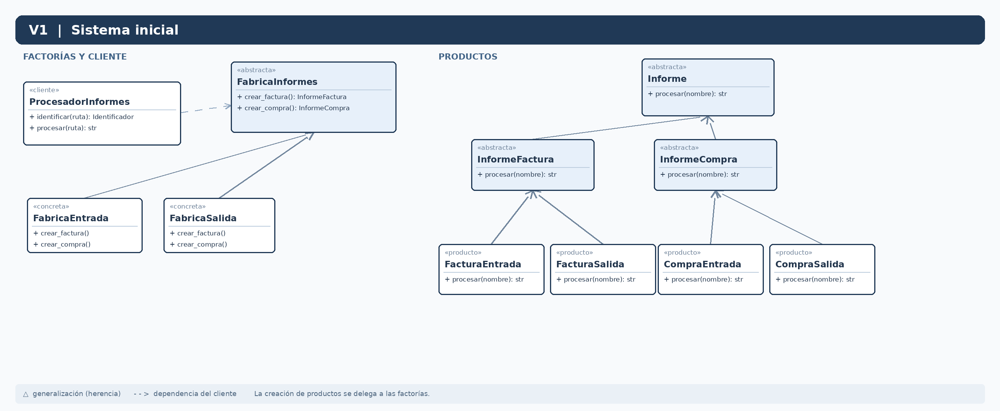

# UNIR · Reutilización de Software · Patrones de creación

Actividad académica desarrollada con **Python** (lenguaje autorizado por el docente en sustitución de Java) para analizar **Abstract Factory** y la evolución de un sistema de procesamiento simulado de informes.

## Estructura

- [`codigo_python/V1_Sistema_Inicial/`](codigo_python/V1_Sistema_Inicial/): ENTRADA y SALIDA × FACTURA y COMPRA (4 combinaciones).
- [`codigo_python/V2_Categoria_Mixta/`](codigo_python/V2_Categoria_Mixta/): añade categoría MIXTA (6 combinaciones).
- [`codigo_python/V3_Tipo_Pedido/`](codigo_python/V3_Tipo_Pedido/): añade tipo PEDIDO solo a ENTRADA (7 combinaciones).
- [`diagramas_uml/`](diagramas_uml/): diagramas UML de clases editables `.drawio` y vistas `.png`.
- [`documentacion/`](documentacion/): memoria académica Word.
- [`evidencias/`](evidencias/): salidas reales de ejecución capturadas en PNG.

## Requisitos

Python **3.10+**. No se necesitan dependencias adicionales.

## Ejecución (desde la raíz)

```bash
python codigo_python/V1_Sistema_Inicial/main.py
python codigo_python/V2_Categoria_Mixta/main.py
python codigo_python/V3_Tipo_Pedido/main.py
```

## Pruebas automatizadas

```bash
python -m unittest discover -s codigo_python/V1_Sistema_Inicial -p "test_*.py" -v
python -m unittest discover -s codigo_python/V2_Categoria_Mixta -p "test_*.py" -v
python -m unittest discover -s codigo_python/V3_Tipo_Pedido -p "test_*.py" -v
```

## Arquitectura

La interfaz `FabricaInformes` declara los métodos `crear_factura()` y `crear_compra()`. Las factorías concretas crean las implementaciones correspondientes a cada categoría. `ProcesadorInformes` depende de las abstracciones e invoca polimórficamente `procesar()`. La selección de factorías y operaciones está centralizada en `main.py` (raíz de composición), no en el procesador.

- **V1 → V2:** se añaden `FabricaMixta`, `FacturaMixta`, `CompraMixta`; solo se registra la categoría nueva en `main.py`.
- **V2 → V3:** se añaden `InformePedido`, `PedidoEntrada` y la interfaz segregada `FabricaPedidos`; `FabricaEntrada` implementa esta capacidad y `main.py` registra el tipo PED. `FabricaSalida` y `FabricaMixta` no necesitan implementar un método de pedido inexistente.

En el UML V3, `FabricaPedidos` se representa como **clase base abstracta** (`ABC`). La relación desde `FabricaEntrada` se dibuja con línea continua y triángulo hueco, propia de la generalización UML, porque el código utiliza herencia múltiple: `FabricaEntrada(FabricaInformes, FabricaPedidos)`. La realización mediante línea discontinua correspondería a modelar `FabricaPedidos` como una interfaz.

**Limitación reconocida:** el uso de una interfaz adicional para PEDIDO constituye una adaptación pragmática del Abstract Factory clásico. No todos los tipos pertenecen a todas las familias; por eso la combinación SAL_PED y MIX_PED se rechaza de forma controlada.

## Diagramas

Cada `.drawio` se puede abrir en [diagrams.net](https://app.diagrams.net/). Las imágenes PNG permiten previsualizarlos desde GitHub:



## Alcance

Los nombres siguen `CAT_TIPO_codigo.txt`. Se simula el procesamiento por pantalla; no se lee contenido físico de archivos y no existe almacenamiento persistente, conforme al caso práctico. Incluye comprobación de nombres mal formados y combinaciones no soportadas como mejora de robustez.

## Referencias

- Refactoring.Guru: [Abstract Factory](https://refactoring.guru/es/design-patterns/abstract-factory).
- Python Software Foundation: [módulo abc](https://docs.python.org/es/3/library/abc.html).
- diagrams.net: [editor de diagramas](https://app.diagrams.net/).
